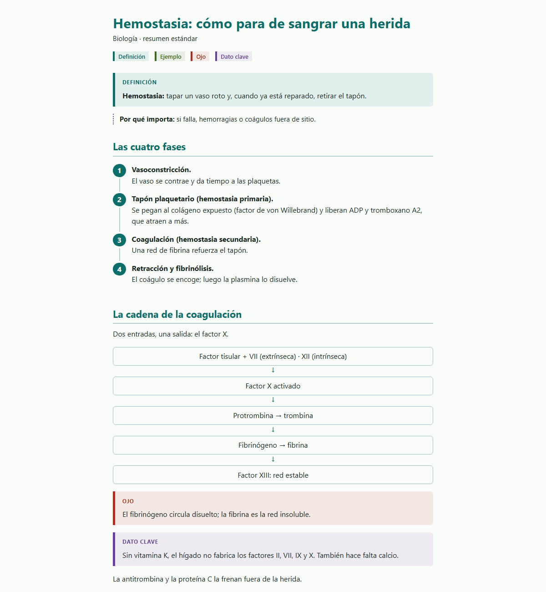
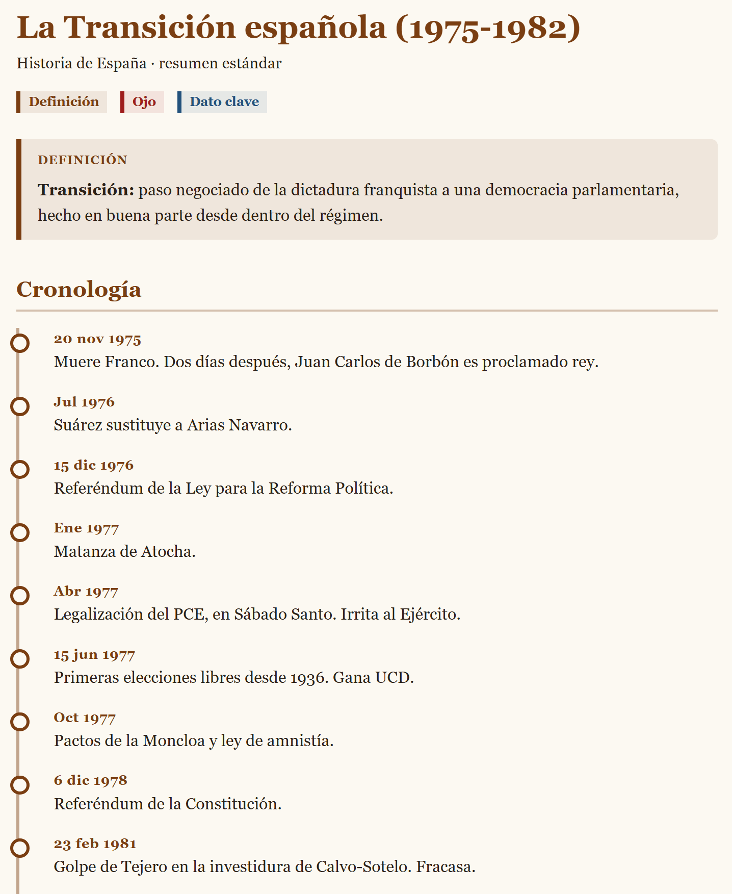
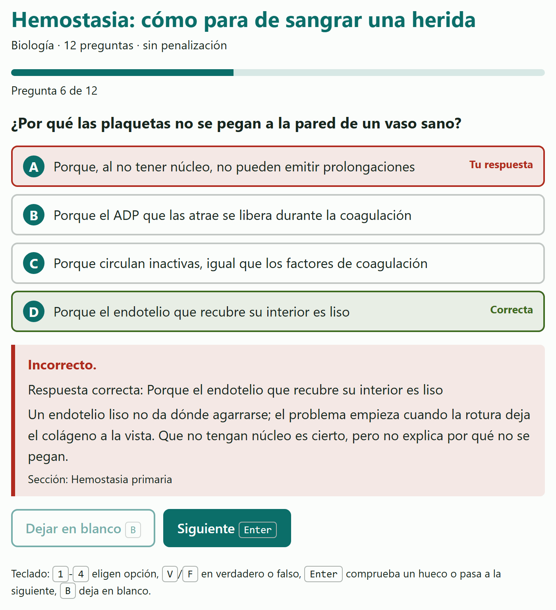
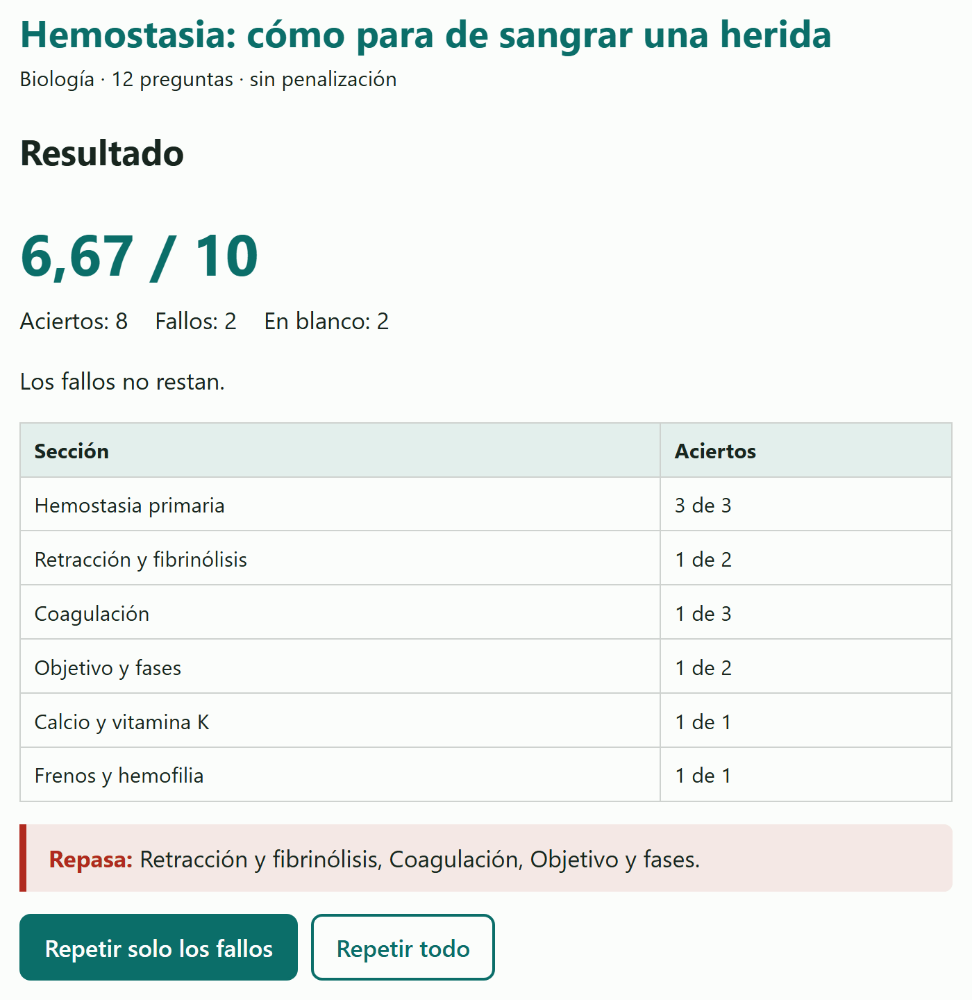
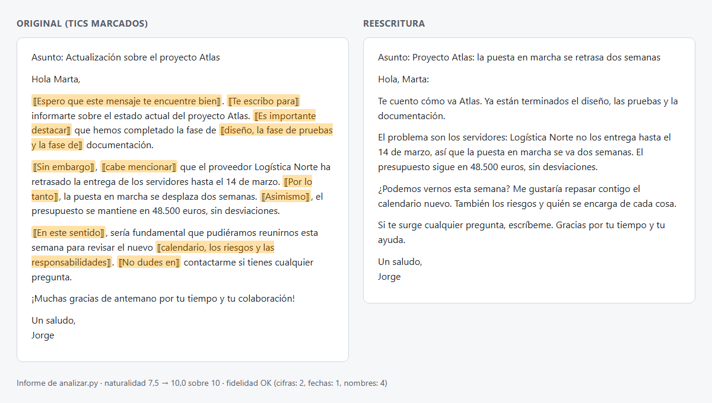

# skills-estudio

[Español](README.md) · **English**

Three skills for AI agents: they turn study material into notes and practice tests, and rewrite texts so they read as written by a person. Built for students, people preparing for civil-service exams, and teachers.

[](LICENSE)
[](https://github.com/churchy-editz/skills-estudio/actions/workflows/validar.yml)
[](https://agentskills.io)

The skills' instructions are written in Spanish and they work in Spanish and English: they answer in the language of the material or the conversation.

## The skills

### creador-apuntes (study notes)

Turns a PDF, a DOCX, a lecture transcript or photos of handwritten notes into notes for learning the topic. Each section takes the shape its content needs: steps for a process, a timeline for a chronology, a table for concepts that get mixed up. The output is a printable HTML file and a DOCX.

| Biology: a process | History: a chronology |
|---|---|
|  |  |

> "Make study notes from this PDF for Thursday's exam."

### creador-tests (practice tests)

Generates a test from the material or from the notes. Wrong options are mistakes real students make, and every question explains why the right answer is right and why the most tempting wrong one fails. It delivers an interactive HTML file that shows the score and a breakdown by section, and lets you retry only the questions you missed. Tests can be exported to Moodle, Kahoot, Anki, Quizlet or Word.

| A question with its explanation | Final result |
|---|---|
|  |  |

> "Make a quiz from this chapter, with a -1/3 penalty for wrong answers."

### reescritor-estilo (style rewriter)

Rewrites a text so it sounds natural and fits its register (academic, professional, casual or social media). Given samples of your own writing, it imitates your voice. Every idea, number, date, name and quote stays, and a script checks that nothing is missing.



> "Make this email sound more natural without changing any of the details."

## Installation

### a) Any compatible agent, with the `skills` CLI

You need Node.js 22.20 or later. From your project folder:

```bash
npx skills add churchy-editz/skills-estudio
```

The CLI detects the agents you have installed and asks where to install. Other options:

```bash
npx skills add churchy-editz/skills-estudio --list                  # list the skills without installing
npx skills add churchy-editz/skills-estudio --skill creador-tests   # just one
npx skills add churchy-editz/skills-estudio -g -a claude-code       # all your projects, Claude Code only
```

### b) Claude Code, Codex or Cursor, by copying the folder

1. Download the repository: `git clone https://github.com/churchy-editz/skills-estudio.git`
2. Copy the folder of each skill you want (the whole folder: `SKILL.md`, `scripts/`, `references/` and `assets/`) into your agent's path:

| Agent | All your projects | One project only |
|---|---|---|
| Claude Code | `~/.claude/skills/` | `.claude/skills/` |
| Codex | `~/.agents/skills/` | `.agents/skills/` |
| Cursor | `~/.cursor/skills/` | `.cursor/skills/` |

macOS or Linux:

```bash
mkdir -p ~/.claude/skills && cp -r skills-estudio/skills/creador-tests ~/.claude/skills/
```

Windows (PowerShell):

```powershell
New-Item -ItemType Directory -Force "$HOME\.claude\skills" | Out-Null
Copy-Item -Recurse skills-estudio\skills\creador-tests "$HOME\.claude\skills\"
```

All three agents pick up new skills on their own. When one doesn't show up, restart the agent. Cursor also reads `.agents/skills/` and `.claude/skills/`.

### c) Claude.ai, ChatGPT and Gemini

**Claude.ai.** Download the skill's zip from the [Releases](https://github.com/churchy-editz/skills-estudio/releases) page and upload it under **Customize > Skills** ([claude.ai/customize/skills](https://claude.ai/customize/skills)): the "+" button, "Create skill", then "Upload a skill". Code execution has to be turned on, under **Settings > Capabilities**.

**ChatGPT and Gemini.** Each skill ships two portable files in its folder (`skills/<skill>/`), meant for chats without skill support:

1. Create a GPT or a Gem and paste the contents of `prompt-portable-lite.md` into the instructions field. The text stays under 7,500 characters: the workflow, the hard rules, the output format and the main checks.
2. Upload `prompt-portable.md` as a knowledge file. This one holds the whole skill, with all its references and templates, and the short instructions point to it.

Without code execution, both files say which checks to do by hand.

## Requirements

- Python 3.11 or later for the scripts, which only use the standard library.
- [python-docx](https://pypi.org/project/python-docx/), only for Word output: `python -m pip install python-docx`. The script that needs it prints the exact command when it's missing.

## How the skills avoid sounding like AI

Generated text usually gives itself away through repeated patterns rather than one particular phrase, so each skill measures those patterns with a script instead of relying on a list of tips. `skills/creador-tests/scripts/validar.py` checks that the questions don't come out of a mould: that they don't all open the same way, that the right answer isn't always the longest or always under the same letter, and that cognitive levels and distractor types are spread out. `skills/reescritor-estilo/scripts/analizar.py` measures sentence rhythm, repeated openings, lists of three, connectors, textbook endings and about 350 filler phrases and clichés in Spanish and English. It also compares the text with the original and reports an error if a number, date, name or quote has gone missing. The notes skill follows a list of banned tone patterns and a self-review before delivering.

## Responsible use

In academic settings, follow your institution's rules on AI use. The rewriter is meant to improve the style of your own texts.

## Contributing

- **New filler phrases or clichés:** open an issue with the "Nueva muletilla o tópico" template. The template asks for the language, the phrase, the alternative and an example of where it shows up.
- **Bugs:** use the "Error" template, with the skill, the agent, the input, and the expected versus actual output.
- **Tests:** from the repo root, with Python 3.11 or later and python-docx installed:

```bash
python -m unittest discover -s skills/creador-apuntes/tests
python -m unittest discover -s skills/creador-tests/tests
python -m unittest discover -s skills/reescritor-estilo/tests
python -m unittest discover -s tools/tests
python tools/comprobar_independencia.py
python tools/validar_frontmatter.py
python tools/generar_portables.py --comprobar
```

If you change a `SKILL.md` or anything under `references/`, regenerate the portable files with `python tools/generar_portables.py`. The portable-file test catches it when you forget, and also when a `SKILL.md` changes and its lite version in `tools/lite/` needs a review. No skill may depend on another: no paths into another skill's folder. Screenshots are rebuilt with `python tools/generar_capturas.py` (needs Chrome or Edge) and the release zips with `python tools/empaquetar.py`.

## License and author

[MIT](LICENSE) © 2026 Iker Iglesias Vigil.
