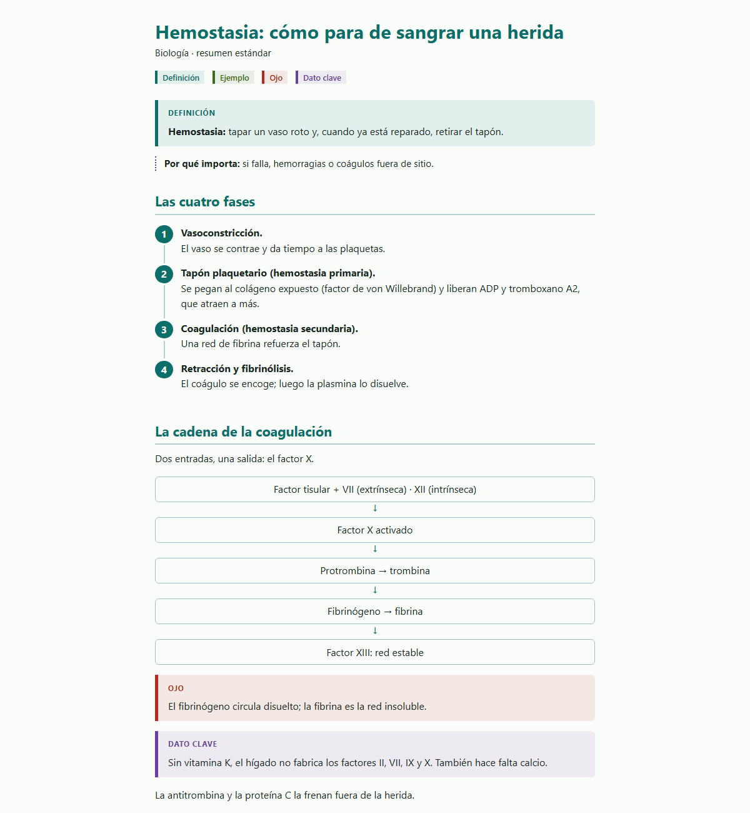
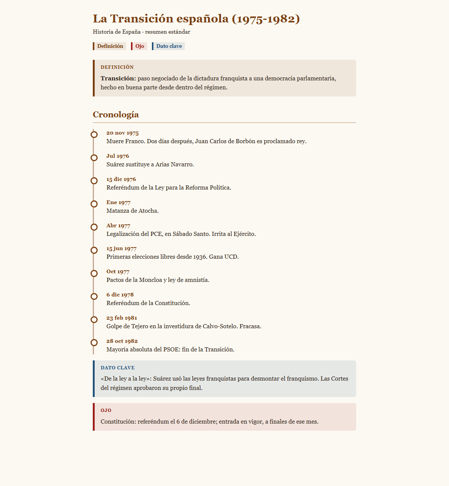
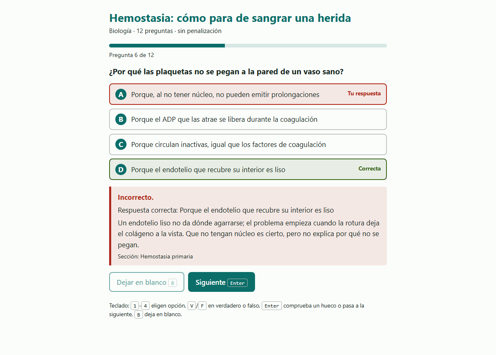
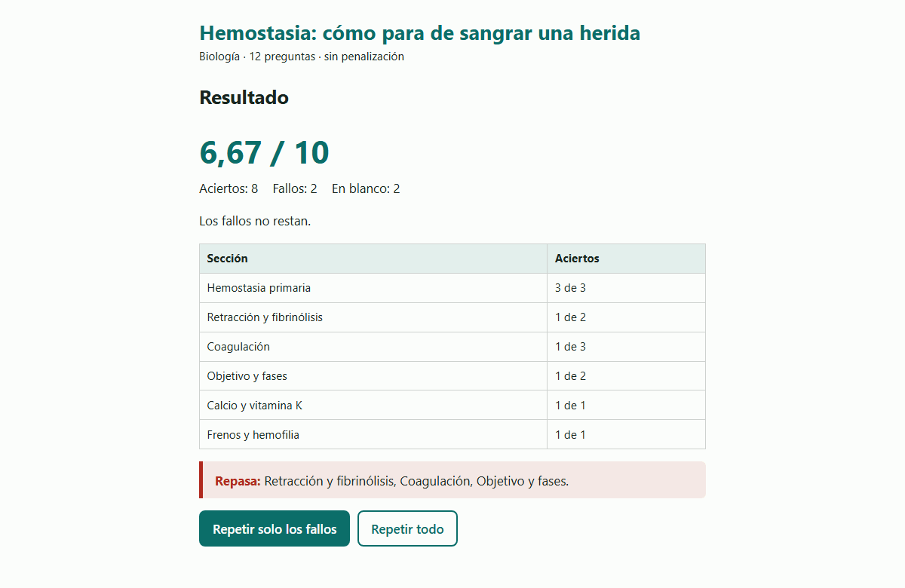
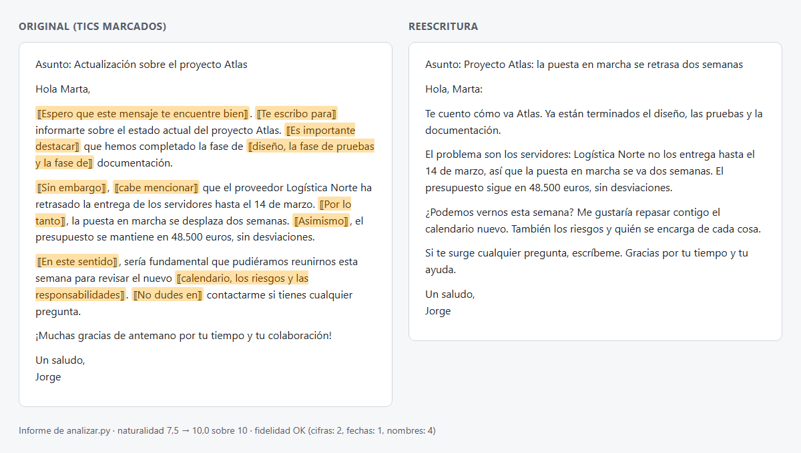

# skills-estudio

**Español** · [English](README.en.md)

Tres skills para agentes de IA: convierten material de estudio en apuntes y en tests de práctica, y reescriben textos para que suenen escritos por una persona. Pensadas para estudiantes, opositores y profesores.

[](LICENSE)
[](https://github.com/churchy-editz/skills-estudio/actions/workflows/validar.yml)
[](https://agentskills.io)

## Las skills

### creador-apuntes

Convierte un PDF, un DOCX, una transcripción de clase o fotos de apuntes en apuntes para aprender el tema. Cada sección toma la forma que pide su contenido: pasos para un proceso, línea de tiempo para una cronología, tabla para conceptos que se confunden. Entrega un HTML imprimible y un DOCX.

| Biología: un proceso | Historia: una cronología |
|---|---|
|  |  |

> «Hazme apuntes de este PDF para el examen del jueves.»

### creador-tests

Genera un test a partir del material o de los apuntes. Las opciones falsas son errores que comete un alumno de verdad, y cada pregunta explica por qué la correcta lo es y por qué falla la opción más tentadora. Entrega un HTML interactivo que da la nota y el desglose por secciones, y permite repetir los fallos. Se puede exportar a Moodle, Kahoot, Anki, Quizlet o Word.

| Pregunta con su explicación | Resultado final |
|---|---|
|  |  |

> «Hazme un test de este tema con penalización de -1/3, que es para la oposición.»

### reescritor-estilo

Reescribe un texto para que suene natural y propio de su registro (académico, profesional, cercano o redes). Con textos tuyos como muestra, imita tu voz. Conserva todas las ideas, cifras, fechas, nombres y citas, y un script comprueba que no falte ninguna.



> «Reescribe este email para que suene más natural, sin cambiar los datos.»

## Instalación

### a) Cualquier agente compatible, con el CLI `skills`

Hace falta Node.js 22.20 o posterior. Desde la carpeta de tu proyecto:

```bash
npx skills add churchy-editz/skills-estudio
```

El CLI detecta los agentes instalados y pregunta dónde instalar. Otras opciones:

```bash
npx skills add churchy-editz/skills-estudio --list                  # ver las skills sin instalar
npx skills add churchy-editz/skills-estudio --skill creador-tests   # solo una
npx skills add churchy-editz/skills-estudio -g -a claude-code       # para todos tus proyectos, solo en Claude Code
```

### b) Claude Code, Codex o Cursor, copiando la carpeta

1. Descarga el repositorio: `git clone https://github.com/churchy-editz/skills-estudio.git`
2. Copia la carpeta de cada skill que quieras (entera: `SKILL.md`, `scripts/`, `references/` y `assets/`) en la ruta de tu agente:

| Agente | Para todos tus proyectos | Solo para un proyecto |
|---|---|---|
| Claude Code | `~/.claude/skills/` | `.claude/skills/` |
| Codex | `~/.agents/skills/` | `.agents/skills/` |
| Cursor | `~/.cursor/skills/` | `.cursor/skills/` |

macOS o Linux:

```bash
mkdir -p ~/.claude/skills && cp -r skills-estudio/skills/creador-tests ~/.claude/skills/
```

Windows (PowerShell):

```powershell
New-Item -ItemType Directory -Force "$HOME\.claude\skills" | Out-Null
Copy-Item -Recurse skills-estudio\skills\creador-tests "$HOME\.claude\skills\"
```

Los tres agentes detectan las skills nuevas solos. Cuando una no aparece, basta con reiniciar el agente. Cursor también lee `.agents/skills/` y `.claude/skills/`.

### c) Claude.ai, ChatGPT y Gemini

**Claude.ai.** Descarga el zip de la skill desde la página de [Releases](https://github.com/churchy-editz/skills-estudio/releases) y súbelo en **Customize > Skills** ([claude.ai/customize/skills](https://claude.ai/customize/skills)): botón «+», «Create skill» y «Upload a skill». Necesita la ejecución de código activada, en **Settings > Capabilities**.

**ChatGPT y Gemini.** Cada skill trae dos portables en su carpeta (`skills/<skill>/`), pensados para chats sin soporte de skills:

1. Crea un GPT o un Gem y pega el contenido de `prompt-portable-lite.md` en el campo de instrucciones. Son menos de 7.500 caracteres: el flujo, las reglas duras, el formato de salida y las comprobaciones principales.
2. Sube `prompt-portable.md` como archivo de conocimiento. Lleva la skill completa, con todas sus referencias y plantillas, y las instrucciones cortas remiten a él.

Sin ejecución de código, los dos indican qué comprobaciones hacer a mano.

## Requisitos

- Python 3.9 o posterior para los scripts, que solo usan la librería estándar.
- [python-docx](https://pypi.org/project/python-docx/), solo para las salidas en Word: `python -m pip install python-docx`. El script que lo necesita da el comando exacto cuando falta.

## Cómo se evita que suene a IA

Los textos generados suelen delatarse por patrones repetidos más que por una frase concreta, así que cada skill mide esos patrones con un script en lugar de confiar en una lista de consejos. `skills/creador-tests/scripts/validar.py` comprueba que las preguntas no salgan en molde: que no empiecen igual, que la correcta no sea siempre la más larga ni caiga siempre en la misma letra, y que se repartan los niveles cognitivos y los tipos de distractor. `skills/reescritor-estilo/scripts/analizar.py` mide el ritmo de las frases, los arranques repetidos, las tríadas, los conectores, los cierres de manual y unas 350 muletillas y frases hechas en español e inglés. Además compara el texto con el original y da error si se ha perdido una cifra, una fecha, un nombre o una cita. Los apuntes siguen una lista de prohibiciones de tono y una autorrevisión antes de entregar.

## Uso responsable

En contextos académicos, respeta las normas de tu centro sobre el uso de IA. El reescritor está pensado para mejorar el estilo de textos propios.

## Contribuir

- **Muletillas y tópicos nuevos:** abre un issue con la plantilla «Nueva muletilla o tópico». Pide el idioma, la frase, la alternativa y un ejemplo de dónde aparece.
- **Errores:** usa la plantilla «Error», con la skill, el agente, la entrada y la salida esperada frente a la obtenida.
- **Tests:** desde la raíz del repo, con Python 3.9 o posterior y python-docx instalado:

```bash
python -m unittest discover -s skills/creador-apuntes/tests
python -m unittest discover -s skills/creador-tests/tests
python -m unittest discover -s skills/reescritor-estilo/tests
python -m unittest discover -s tools/tests
python tools/comprobar_independencia.py
python tools/validar_frontmatter.py
python tools/generar_portables.py --comprobar
```

Si cambias un `SKILL.md` o algo de `references/`, regenera los portables con `python tools/generar_portables.py`. El test de portables avisa cuando se te olvida, y también cuando cambia un `SKILL.md` y hay que revisar su versión lite en `tools/lite/`. Ninguna skill puede depender de otra: nada de rutas a la carpeta de otra skill. Las capturas se regeneran con `python tools/generar_capturas.py` (necesita Chrome o Edge) y los zips de las Releases, con `python tools/empaquetar.py`.

## Licencia y autor

[MIT](LICENSE) © 2026 Iker Iglesias Vigil.
