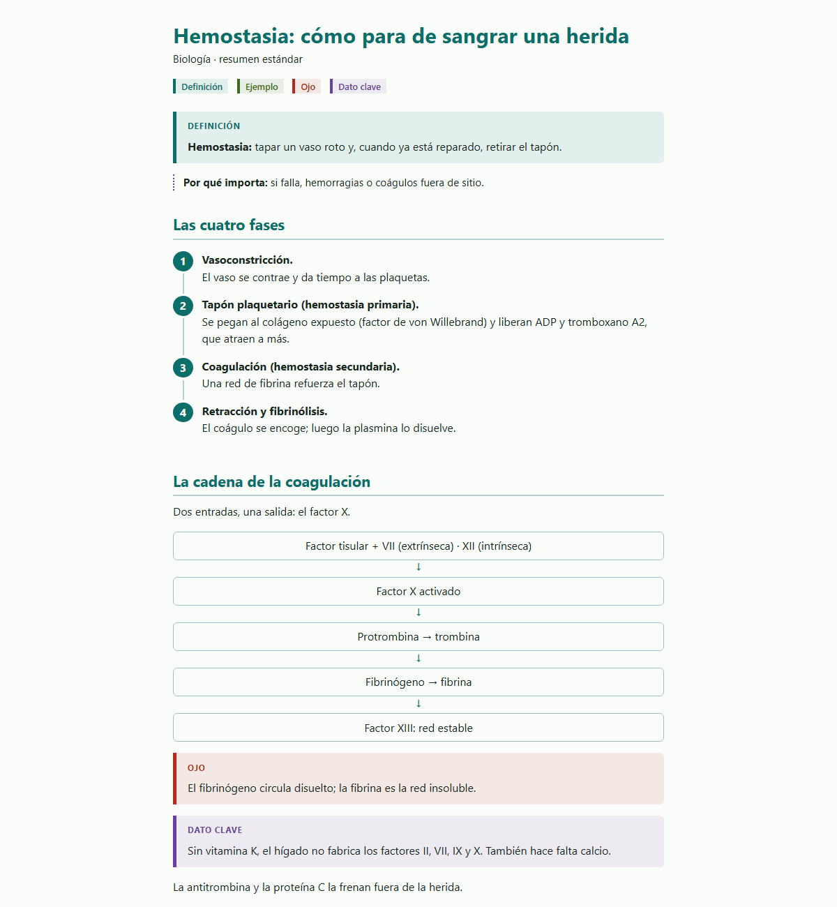

# creador-apuntes

Convierte material de estudio (PDF, DOCX, texto pegado, transcripciones de clase o fotos de apuntes) en apuntes para aprender el tema. La estructura sale del contenido: pasos numerados para un proceso, línea de tiempo para una cronología, tabla comparativa para conceptos que se confunden, árbol para una clasificación. Antes de escribir pregunta una sola cosa, la extensión, y entrega un HTML imprimible y un DOCX con cajas de color (definición, ejemplo, ojo, dato clave) que también se entienden impresas en blanco y negro.

## Ejemplo de uso

> «Hazme apuntes de este PDF, versión estándar.»

El agente calcula la extensión sobre el original, elige la paleta de la asignatura y la estructura de cada sección, y entrega `apuntes-<tema>.html` y `apuntes-<tema>.docx`.

## Archivos

| Archivo | Para qué |
|---|---|
| `SKILL.md` | Instrucciones de la skill |
| `assets/plantilla-base.html` | Plantilla del HTML, con estilos de impresión |
| `references/estructuras.md` | HTML de cada estructura (pasos, línea de tiempo, tabla, árbol, cadena, Cornell) y patrones de uso |
| `references/paletas.md` | Paletas por asignatura, con contraste WCAG AA verificado |
| `references/patrones.md` | Ajustes según el tipo de fuente, por ejemplo diapositivas |
| `references/tono.md` | Prohibiciones de tono y ejemplos |
| `scripts/html_a_docx.py` | Convierte el HTML en DOCX (necesita python-docx) |
| `prompt-portable.md` | Todo lo anterior en un solo texto, para subir como archivo de conocimiento en chats sin skills |
| `prompt-portable-lite.md` | Lo esencial en menos de 7.500 caracteres, para el campo de instrucciones de un GPT o un Gem |
| `examples/` | Dos fuentes inventadas y sus apuntes: hemostasia (biología) y la Transición (historia) |
| `tests/` | Tests del conversor |

Instalación y requisitos: [README del repositorio](../../README.md#instalación).
