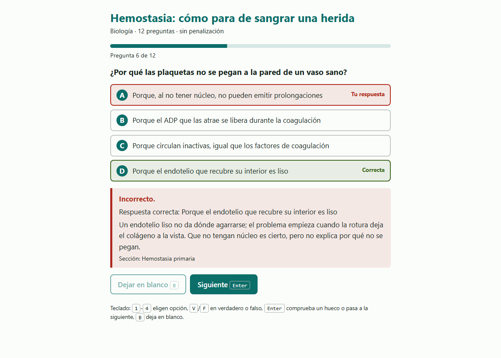
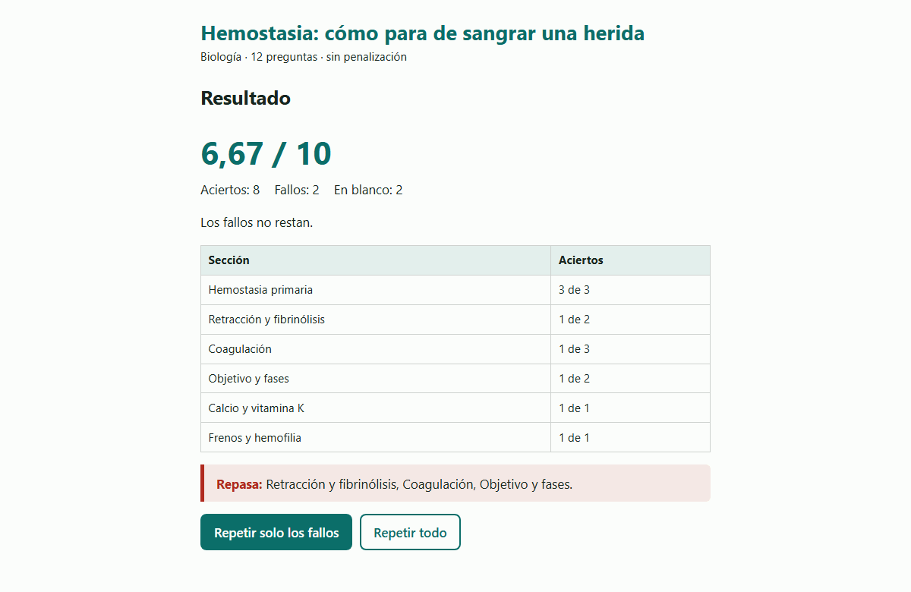

# creador-tests

Genera tests para aprender a partir de material de estudio o de los apuntes de creador-apuntes. Mezcla opción múltiple, verdadero/falso, huecos y casos prácticos. Las opciones falsas son errores reales de alumno, y cada explicación dice por qué la correcta lo es y por qué falla el distractor más tentador. Un validador comprueba que el test no tenga forma de molde antes de entregarlo.

## Ejemplo de uso

> «Hazme un test de este tema, 20 preguntas, dificultad progresiva.»

El agente planifica el reparto de preguntas por secciones y niveles, escribe el JSON, lo valida con `scripts/validar.py` hasta llegar a 10/10 y genera un HTML interactivo: una pregunta cada vez, nota final con desglose por secciones, repetir solo los fallos y versión imprimible con las soluciones aparte. A petición, lo exporta a Moodle (GIFT), Kahoot (CSV), Anki, Quizlet o Word.

## Archivos

| Archivo | Para qué |
|---|---|
| `SKILL.md` | Instrucciones de la skill |
| `assets/plantilla-test.html` | Plantilla del test interactivo |
| `references/esquema.md` | Formato del JSON del test |
| `references/variedad.md` | Límites antimolde, formas de enunciado y técnicas de distractor |
| `references/reglas-preguntas.md` | Reglas de calidad de cada pregunta, con ejemplos |
| `references/tono.md` | Tono de enunciados y explicaciones |
| `scripts/validar.py` | Valida el JSON: errores de esquema y avisos de patrón, con nota de variedad |
| `scripts/generar_html.py` | Genera el HTML interactivo con la paleta de la asignatura |
| `scripts/exportar.py` | Exporta a GIFT, CSV de Kahoot, Anki, Quizlet o DOCX |
| `prompt-portable.md` | Todo lo anterior en un solo texto, para subir como archivo de conocimiento en chats sin skills |
| `prompt-portable-lite.md` | Lo esencial en menos de 7.500 caracteres, para el campo de instrucciones de un GPT o un Gem |
| `examples/` | Test de ejemplo sobre hemostasia (JSON y HTML) |
| `tests/` | Tests de los scripts |

Instalación y requisitos: [README del repositorio](../../README.md#instalación).
