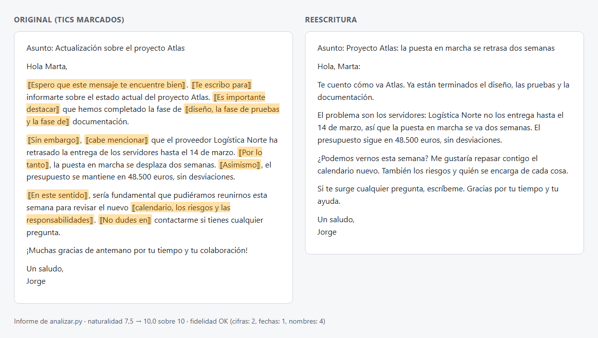

# reescritor-estilo

Reescribe textos para que suenen naturales y propios de su registro: académico, profesional, cercano o redes. Con una a tres muestras de texto del usuario, extrae su perfil de voz y lo aplica a la reescritura. Conserva todas las ideas y, tal cual, cifras, fechas, nombres propios, citas y referencias. Un script mide la naturalidad (muletillas, tópicos, ritmo, arranques, tríadas, cierres) y la fidelidad (lo que falte del original es un error).

## Ejemplo de uso

> «Haz que este email suene más natural, más directo.»

El agente detecta el tipo de texto y su registro, pregunta la intensidad (ligera, media o profunda), reescribe y pasa `scripts/analizar.py` sobre el original y la reescritura hasta que no quedan avisos. Si la entrada es un DOCX, devuelve un DOCX con los mismos estilos de título.

## Archivos

| Archivo | Para qué |
|---|---|
| `SKILL.md` | Instrucciones de la skill |
| `references/patrones-ia.md` | Muletillas, conectores, tópicos y cierres en español e inglés, con su alternativa. El analizador lee las listas de aquí |
| `references/variedad.md` | Técnicas de ritmo y arranque, límites del analizador y pares antes/después |
| `references/registros.md` | Qué cambia en cada registro y sus tics propios |
| `references/voz.md` | Cómo extraer y aplicar el perfil de voz del usuario |
| `scripts/analizar.py` | Informe de naturalidad y fidelidad (`--marcar` señala los tics en el original) |
| `scripts/docx_io.py` | Extrae el texto de un DOCX y lo vuelve a escribir conservando estilos (necesita python-docx) |
| `prompt-portable.md` | Todo lo anterior en un solo texto, para subir como archivo de conocimiento en chats sin skills |
| `prompt-portable-lite.md` | Lo esencial en menos de 7.500 caracteres, para el campo de instrucciones de un GPT o un Gem |
| `examples/` | Textos inventados: párrafo académico, email, post de LinkedIn y un ejemplo de voz, con sus informes |
| `tests/` | Tests de los scripts |

Instalación y requisitos: [README del repositorio](../../README.md#instalación).
